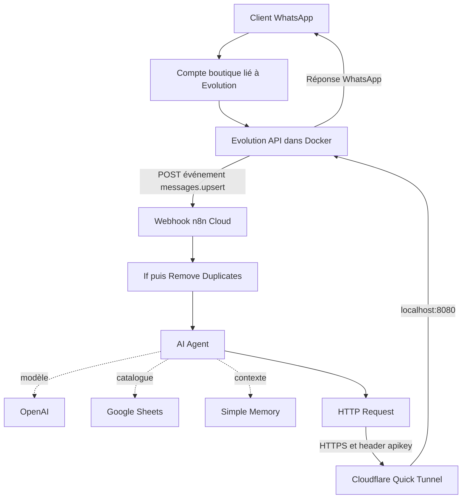

# WhatsApp Boutique Atlas — AI Customer Support avec n8n

Assistant WhatsApp de démonstration pour une boutique fictive. Il répond aux questions sur le catalogue Google Sheets, conserve le contexte d'une conversation et transmet ses réponses via Evolution API. Les échanges ont été testés en français et en darija.

## 1. Technologies et environnement utilisés

| Composant | Où il fonctionne dans la démonstration | Rôle |
| --- | --- | --- |
| WhatsApp | Téléphones du compte boutique et du contact de test | Réception et lecture des messages |
| Evolution API | Docker Desktop sur un PC Windows, version observée 2.3.7 | Connexion WhatsApp et API d'envoi/réception |
| PostgreSQL | Conteneur du stack Evolution, PostgreSQL 15 | Base evolution utilisée par Evolution API |
| Redis | Conteneur du stack Evolution, Redis 7 Alpine | Cache Redis activé par le fichier Compose fourni |
| n8n Cloud | Hébergement n8n en ligne | Orchestration du workflow et exécutions automatiques |
| OpenAI Chat Model | Appelé depuis n8n | Génération des réponses ; modèle de l'export : `gpt-5-mini` |
| Google Sheets | Compte Google du propriétaire | Catalogue de référence, lu avec le tool Get Row(s) |
| Simple Memory | Dans l'instance n8n | Historique court, séparé par instance WhatsApp et contact |
| Cloudflare Quick Tunnel | Processus `cloudflared` sur Windows | Rend l'API locale accessible en HTTPS depuis n8n Cloud |
| PowerShell | PC Windows | Démarrage du tunnel et configuration du webhook Evolution |

**n8n n'est pas installé dans le Docker local de cette démonstration.** Les conteneurs PostgreSQL et Redis montrés avec Evolution ne constituent pas la mémoire de l'AI Agent : celui-ci utilise Simple Memory.

Le groupe Docker observé est `evolution-api`, avec `evolution-1`, `postgres-1` et `redis-1`. Le port Evolution est publié en `8080:8080`. Les noms peuvent changer selon le projet Compose.

## 2. Architecture et sens des communications



Deux routes distinctes sont utilisées :

- **Entrée :** Evolution envoie l'événement à l'URL publique du Webhook n8n. Le header `x-webhook-secret` protège cette entrée.
- **Sortie :** n8n appelle l'URL publique Cloudflare d'Evolution avec le header `apikey`. Le tunnel rejoint `http://localhost:8080` sur Windows.

`localhost` depuis n8n Cloud ne désigne pas le PC Windows. C'est pourquoi l'envoi utilise le tunnel. Le renouvellement du tunnel modifie l'URL du nœud HTTP Request, pas celle du Webhook n8n.

## 3. Pipeline n8n, étape par étape

| Nœud | Traitement |
| --- | --- |
| Webhook | Reçoit un POST authentifié contenant l'événement WhatsApp |
| If | Exige `messages.upsert`, `fromMe = false` et le contact de test autorisé |
| Remove Duplicates | Ne garde que les identifiants de messages non traités lors des exécutions précédentes |
| AI Agent | Lit le texte du client, consulte le catalogue si nécessaire et produit une réponse |
| OpenAI Chat Model | Modèle connecté à l'agent |
| Google Sheets Tool | Lit les lignes du catalogue de la boutique |
| Simple Memory | Fournit le contexte des échanges précédents du même contact |
| HTTP Request | Envoie la sortie de l'agent au contact source avec Evolution API |

Le filtre `fromMe = false` écarte les messages émis par le compte boutique. Le filtre sur le contact garde cette version limitée à un testeur. La sortie False n'est pas raccordée au parcours de réponse.

### Expressions de l'export

Texte entrant dans l'agent :

```javascript
{{ $json.message || $json.body?.data?.message?.conversation }}
```

Identifiant de déduplication :

```javascript
{{ $json.body.data.key.id }}
```

Session de mémoire :

```javascript
{{ 'v2:' + $('Webhook').item.json.body.instance + ':' + $('Webhook').item.json.body.data.key.remoteJid }}
```

Corps JSON du HTTP Request, en mode Expression :

```javascript
{{ {
  "number": $('Webhook').item.json.body.data.key.remoteJid,
  "text": $json.output
} }}
```

L'export JSON contient ces expressions avec le préfixe `=` utilisé par n8n. Conserver le remoteJid complet : un identifiant finissant par `@lid` n'est pas un numéro de téléphone à convertir en retirant son suffixe. L'envoi vers le LID du contact a fonctionné dans la démonstration ; la compatibilité dépend de la version/session Evolution.

La branche séparée Manual Trigger → Edit Fields est conservée. Elle contient un texte d'exemple et ne rejoint pas le parcours WhatsApp : elle ne constitue pas un test de bout en bout.

## 4. Contenu du dépôt

| Fichier | Contenu |
| --- | --- |
| `workflow.json` | Workflow n8n nettoyé, inactif à l'import, sans références credentials |
| `catalogue-demo.csv` | Données fictives à importer dans Google Sheets |
| `README.md` | Architecture, configuration, utilisation, tests et limites |
| `.gitignore` | Exclusions de base pour fichiers privés et journaux |
| `docker-compose.yml` | Stack local Evolution 2.3.7, PostgreSQL 15 et Redis 7 Alpine, dérivé du fichier de la démonstration |
| `.env.example` | Variables à renseigner localement, sans valeurs secrètes |

Captures facultatives à ajouter après masquage des informations personnelles : `workflow.png`, `conversation-1.png`, `conversation-2.png`, `docker-services.png`. Elles ne sont pas incluses dans cette archive.

Le Compose de la démonstration est maintenant inclus. Les changements pour publication sont limités à deux contrôles : mot de passe PostgreSQL obligatoire et clé globale Evolution obligatoire, tous deux lus depuis `.env`. Les images, services, connexions, volumes, restart policies et port d'origine sont conservés. Le `.env` privé d'origine n'a pas été fourni et n'est pas distribué ; `.env.example` propose les deux variables explicitement nécessaires au modèle publié. D'autres réglages privés de l'installation d'origine peuvent donc ne pas être reproduits. Le template n'a pas été démarré sur une installation neuve pendant cette préparation.

## 5. Prérequis

- Docker Desktop opérationnel sous Windows avec Docker Compose, ou une autre installation Evolution accessible.
- `cloudflared` installé si Evolution reste sur le PC local.
- Compte n8n et accès aux nœuds utilisés dans le workflow.
- Accès API OpenAI, clé personnelle et crédit/quota nécessaires ; un abonnement ChatGPT ne remplace pas cet accès API.
- Compte Google avec autorisation de lecture du catalogue depuis n8n.
- Compte WhatsApp lié à Evolution et second contact pour les tests.

## 6. Préparer Docker et connecter WhatsApp

### Installation du stack

Sur une **nouvelle installation**, extraire ce dépôt dans un dossier dédié. Avec Docker Desktop démarré, ouvrir PowerShell dans le dossier contenant `docker-compose.yml` :

```powershell
Copy-Item .env.example .env
notepad .env
```

Ne pas exécuter la copie si un `.env` existe déjà : elle pourrait écraser les paramètres d'une installation fonctionnelle. Ne pas remplacer le dossier Evolution existant pour simplement publier ce dépôt.

Dans le nouveau `.env`, renseigner deux secrets différents, longs et aléatoires : `POSTGRES_PASSWORD` et `AUTHENTICATION_API_KEY`. Par exemple, générer localement deux valeurs hexadécimales de 32 octets chacune avec ce script PowerShell ; elles ne doivent jamais être copiées dans GitHub, une capture ou un message public :

```powershell
$rng = [System.Security.Cryptography.RandomNumberGenerator]::Create()
try {
  foreach ($label in @("POSTGRES_PASSWORD", "AUTHENTICATION_API_KEY")) {
    $bytes = New-Object byte[] 32
    $rng.GetBytes($bytes)
    $hex = [BitConverter]::ToString($bytes).Replace("-", "").ToLowerInvariant()
    Write-Output "$label=$hex"
  }
} finally {
  $rng.Dispose()
  Remove-Variable bytes, hex, label -ErrorAction SilentlyContinue
}
```

Le script affiche des secrets uniquement sur votre terminal local ; les placer dans `.env`. Un mot de passe hexadécimal évite d'avoir à encoder des caractères réservés dans l'URI PostgreSQL construite par ce Compose.

Vérifier la configuration sans afficher les valeurs, puis démarrer :

```powershell
docker compose config --quiet
docker compose up -d
docker compose ps
```

Les variables vides provoquent volontairement une erreur : les renseigner avant de démarrer. Le service Evolution lit aussi `.env` via `env_file`.

Le Compose configure :

- `evoapicloud/evolution-api:v2.3.7`, `postgres:15` et `redis:7-alpine` ;
- PostgreSQL : utilisateur et base `evolution`, mot de passe depuis `.env` ;
- Evolution : connexion PostgreSQL interne sur `postgres:5432`, cache sur `redis:6379/1` ;
- port Evolution lié à **127.0.0.1:8080**, sans publication des ports PostgreSQL et Redis sur l'hôte ;
- trois volumes nommés : `postgres_data`, `redis_data`, `evolution_instances` ;
- politique `restart: unless-stopped` pour les trois services.

Les noms des conteneurs dépendent du nom du dossier/projet Compose. `depends_on` organise le démarrage mais ne vérifie pas que la base est prête ; lors du premier lancement, attendre puis examiner les journaux si Evolution redémarre. Le template n'ajoute pas de healthchecks.

On peut ensuite démarrer/arrêter les services dans Docker Desktop. Vérifier que les trois services sont démarrés et qu'Evolution est joignable sur le port 8080. Pour arrêter sans supprimer les données :

```powershell
docker compose stop
```

Ne pas supprimer les volumes pour redémarrer. Ne pas utiliser `docker compose down -v` sur des données à conserver. Le changement de `POSTGRES_PASSWORD` dans `.env` ne modifie pas à lui seul le mot de passe d'une base déjà initialisée ; une rotation exige une mise à jour cohérente de la base et de l'application, pas une suppression des données.

### Connexion WhatsApp

1. Ouvrir `http://localhost:8080/manager/`.
2. Utiliser `http://localhost:8080` comme Server URL et la clé globale de votre propre installation.
3. Créer ou sélectionner une instance. La démonstration utilisait `whatsapp-test` ; le template utilise `YOUR_INSTANCE_NAME`.
4. Demander le QR code et le scanner depuis les appareils connectés de WhatsApp sur le téléphone du compte boutique.
5. Attendre l'état **Connected**.

## 7. Préparer le catalogue Google Sheets

Importer `catalogue-demo.csv` dans une feuille Google Sheets personnelle. Conserver ces en-têtes :

| Produit | Prix_DH | Taille | Couleur | Stock |
| --- | --- | --- | --- | --- |
| T-shirt | 120 | S,M,L | Noir,Blanc | Disponible |
| Jeans | 250 | 38,40,42 | Bleu,Noir | Disponible |
| Veste | 350 | M,L | Noir | Rupture |
| Robe | 300 | S,M,L | Rouge,Noir | Disponible |

Ces données sont fictives. Le tableau décrit un stock par produit, pas une quantité pour chaque combinaison taille/couleur. Ne pas annoncer une disponibilité détaillée par variante sans données correspondantes.

## 8. Importer et configurer n8n

1. Importer `workflow.json`. Laisser le workflow inactif le temps de l'installation.
2. Reconnecter le credential OpenAI au Chat Model. Sélectionner un modèle accessible à votre compte si celui de l'export ne l'est pas.
3. Reconnecter Google Sheets, sélectionner le document et l'onglet réels. Le tool doit utiliser **Get Row(s)** ; remplacer `YOUR_GOOGLE_SHEET_ID` et vérifier l'onglet proposé `Feuille 1`.
4. Dans If, remplacer `YOUR_TEST_CONTACT_JID` par le `body.data.key.remoteJid` exact du contact de test. Ne pas enlever cette restriction pour les premiers essais.
5. Garder les connexions du modèle, du tool et de Simple Memory à l'AI Agent.
6. Vérifier le prompt : consultation du catalogue pour les informations produit, réponses limitées à la question, langue du client et politiques fictives clairement signalées.

### Deux credentials Header Auth distincts

| Usage | Champ Name du credential | Champ Value |
| --- | --- | --- |
| Webhook entrant n8n | `x-webhook-secret` | Secret choisi pour protéger le Webhook |
| HTTP Request vers Evolution | `apikey` | Clé globale Evolution de votre installation |

Créer deux objets credentials différents, par exemple `Webhook Secret` et `Evolution API`. Modifier un credential partagé modifie tous les nœuds qui l'utilisent. Le champ Name ci-dessus est le nom du header HTTP, pas le titre du credential.

### Mémoire

Session ID : **Define below / custom key**, avec l'expression documentée en section 3. Utiliser par exemple une fenêtre de 5 interactions dans l'interface. Le préfixe `v2:` sépare le contexte des anciennes sessions ; le modifier ouvre un nouveau contexte pour tous les contacts concernés, sans effacer les historiques précédents.

Simple Memory est locale à l'instance n8n et n'est pas adaptée au mode queue avec plusieurs workers. Prévoir un backend persistant compatible pour une exploitation durable. Redis/PostgreSQL du Docker local ne sont pas automatiquement connectés à cette mémoire.

## 9. Ouvrir le tunnel pour l'envoi

Docker doit être actif avant de démarrer le tunnel. Dans une fenêtre PowerShell séparée :

```powershell
cloudflared tunnel --url http://localhost:8080
```

Garder la fenêtre ouverte. Copier uniquement l'adresse HTTPS générée par votre propre processus. Dans HTTP Request, utiliser :

```text
https://YOUR_EVOLUTION_API_HOST/message/sendText/YOUR_INSTANCE_NAME
```

- Method : **POST**.
- Authentication : **Generic Credential Type → Header Auth**, credential `apikey`.
- Send Body : activé ; Body Content Type : **JSON** ; Specify Body : **Using JSON**.
- Corps : l'expression `number` et `text` de la section 3.

Un Quick Tunnel est temporaire. À chaque nouvelle adresse, modifier le domaine du HTTP Request, conserver son chemin d'envoi, puis republier le workflow. Un domaine fixe nécessite une autre configuration de tunnel/hébergement.

## 10. Configurer Evolution pour appeler n8n

Webhook n8n : **POST**, path `whatsapp-ecommerce-v2`, authentification **Header Auth**, réponse **Immediately**.

- Test : `https://YOUR_N8N_HOST/webhook-test/whatsapp-ecommerce-v2`, uniquement pendant une écoute de test.
- Production : `https://YOUR_N8N_HOST/webhook/whatsapp-ecommerce-v2`, après publication du workflow.

Copier l'URL réellement affichée par votre nœud. Configurer dans Evolution : Enabled, événement `MESSAGES_UPSERT`, `byEvents=false`, `base64=false`, header `x-webhook-secret` identique au credential entrant.

Le Manager utilisé pendant la démonstration ne présentait pas de champ de headers personnalisés. Le webhook a donc été configuré avec le script PowerShell suivant. Il est dérivé de l'appel utilisé avec Evolution 2.3.7 ; adapter le schéma si votre version diffère.

Ouvrir une **autre** fenêtre PowerShell, sans fermer celle du tunnel. Remplacer les deux valeurs demandées dans les premiers prompts par votre instance et l'URL n8n choisie. Saisir les clés aux prompts masqués, sans les écrire dans le fichier :

```powershell
$evoInstance = Read-Host "Nom de votre instance Evolution"
$n8nWebhookUrl = Read-Host "URL du Webhook n8n (test ou production)"
$evoKey = Read-Host "Evolution API Key Global" -AsSecureString
$webhookSecret = Read-Host "Secret du credential Webhook n8n" -AsSecureString

try {
  $evoPlain = [System.Net.NetworkCredential]::new("", $evoKey).Password
  $webhookPlain = [System.Net.NetworkCredential]::new("", $webhookSecret).Password
  $payload = @{
    webhook = @{
      enabled = $true
      url = $n8nWebhookUrl
      byEvents = $false
      base64 = $false
      headers = @{ "x-webhook-secret" = $webhookPlain }
      events = @("MESSAGES_UPSERT")
    }
  } | ConvertTo-Json -Depth 5

  $instancePath = [Uri]::EscapeDataString($evoInstance)
  $null = Invoke-RestMethod `
    -Uri "http://localhost:8080/webhook/set/$instancePath" `
    -Method Post `
    -Headers @{ apikey = $evoPlain } `
    -ContentType "application/json" `
    -Body $payload

  Write-Host "Webhook configured successfully"
} catch {
  Write-Host $_.Exception.Message
} finally {
  Remove-Variable evoInstance, instancePath, n8nWebhookUrl, evoKey, webhookSecret, evoPlain, webhookPlain, payload -ErrorAction SilentlyContinue
}
```

La réussite de cet appel confirme la configuration du webhook, pas la livraison d'une réponse au client. Vérifier ensuite le parcours WhatsApp complet.

## 11. Test, publication et utilisation quotidienne

### Premier test

1. Avec une URL de test configurée dans Evolution, lancer l'écoute du Webhook n8n.
2. Envoyer un nouveau texte depuis le contact autorisé au compte boutique.
3. Vérifier les conditions If, la sortie Kept de Remove Duplicates et la réponse de l'agent.
4. Poser une question produit et vérifier que Google Sheets a effectivement été consulté.
5. Vérifier la réception du message sur le téléphone du contact, pas seulement la couleur verte du HTTP Request.

### Fonctionnement automatique

1. Enregistrer puis publier/activer le workflow selon l'interface n8n.
2. Configurer l'URL **Production** dans Evolution avec le script précédent.
3. Envoyer un nouveau message sans cliquer Execute.
4. Consulter **Executions** dans n8n pour les traces des exécutions de production.

### Après avoir rallumé le PC

1. Démarrer Docker et les services Evolution/PostgreSQL/Redis.
2. Vérifier que l'instance WhatsApp est connectée.
3. Relancer `cloudflared`, copier le nouveau domaine dans HTTP Request et republier.
4. Conserver l'URL de production n8n dans Evolution si elle n'a pas changé.
5. Tester depuis le contact autorisé.

Le PC, Docker et le processus du tunnel doivent rester actifs. La publication du workflow dans n8n Cloud ne rend pas Evolution local indépendant du PC.

## 12. Scénarios de démonstration

Envoyer les questions séparément et attendre la réponse avant la suivante.

| Message de test | Résultat attendu |
| --- | --- |
| Bonjour | Accueil Boutique Atlas selon le contexte et le prompt |
| Est-ce que le T-shirt est disponible ? | Confirmation de disponibilité seulement |
| Quel est son prix ? | 120 DH, avec référence au T-shirt de l'échange précédent |
| Quelles tailles ? | S, M, L |
| Et les couleurs ? | Noir et Blanc |
| La veste est-elle disponible ? | Rupture, sans inventer une date de retour |
| Avez-vous des chaussures Nike ? | Produit absent du catalogue, sans prix inventé |
| Livrez-vous à Rabat ? | Disponibilité de la livraison, mention démo |
| Combien coûte la livraison ? | 30 DH par commande, mention démo |
| Merci | Réponse brève, sans relancer tout le catalogue |

La démonstration sur la configuration d'origine a validé réception/réponse automatique, réponses catalogue, rupture, produit absent, politiques fictives et suivi du contexte. Le template nettoyé n'a pas été réimporté et exécuté avec de nouveaux services. Un résultat attendu n'est pas une garantie du comportement du modèle à chaque exécution.

## 13. Prompt et politiques de démonstration

L'export conserve le System Message fourni, sans réécriture lors du nettoyage. Il décrit notamment : réponses de 1 à 3 phrases, portée stricte de la question, accueil, catalogue et politiques fictives.

- Livraison à Casablanca, Rabat et Marrakech : 30 DH ; estimation 2–4 jours ouvrés.
- Paiement en espèces à la livraison.
- Échange sous 7 jours si article inutilisé avec étiquettes ; livraison d'échange 30 DH.
- Politique de remboursement non définie : ne pas la confirmer.

**Ces conditions ne sont pas celles d'un commerce réel.** Les remplacer avant une utilisation commerciale. Ne pas promettre de notification de réassort : aucun système de notification n'est implémenté. Si cette règle n'est pas explicite dans le System Message importé, l'y ajouter. Les ajustements discutés après un export doivent être ajoutés ou exportés séparément.

## 14. Dépannage

| Symptôme | Vérification / action |
| --- | --- |
| Webhook n8n : 403 | Comparer le nom `x-webhook-secret` et sa valeur côté Evolution et credential Webhook ; vérifier que le credential n'a pas été remplacé par celui de l'API |
| Appel Evolution : 401/403 | Vérifier `apikey` et la clé globale de la bonne installation |
| n8n : webhook non enregistré / 404 | URL de test : activer l'écoute ; URL production : publier et vérifier le path |
| Ancien tunnel / Tunnel not found | Arrêter cloudflared avec Ctrl+C, relancer, remplacer le domaine du HTTP Request et republier |
| Tunnel actif mais origine inaccessible | Vérifier Docker, le port 8080 et l'accès local au Manager |
| Message écarté par If | Vérifier event, fromMe et le remoteJid exact autorisé |
| Aucun item après Remove Duplicates | Envoyer un nouveau message avec un nouvel id plutôt que rejouer le même événement |
| Réponse générique, contexte perdu | Vérifier le raccordement Memory et la stabilité de la sessionKey |
| Réponse produit non vérifiée | Vérifier l'appel outil Google Sheets, son autorisation et les en-têtes |
| HTTP Request vert mais rien reçu | Examiner le résultat Evolution et le statut WhatsApp, puis vérifier destinataire, connexion et compatibilité LID |

## 15. Limites et évolutions possibles

- Version de démonstration limitée à un contact autorisé.
- Pas de prise de commande, réservation, paiement, confirmation de livraison ni alerte de réassort.
- Entrée prévue pour le texte `conversation` ou le champ `message` ; pas de parcours dédié aux images, audios et autres messages.
- Simple Memory n'est pas une garantie de conservation durable ; pas de mémoire métier reliée au PostgreSQL/Redis local.
- Des messages rapprochés peuvent déclencher des exécutions concurrentes ; pas de file d'attente par contact ni regroupement de messages.
- Déduplication sur l'id du message uniquement ; pas de garantie transactionnelle de traitement exactement une fois, et un message peut être marqué traité avant un échec en aval.
- L'agent peut produire une réponse imparfaite : les instructions ne remplacent pas la validation des appels outils et des résultats.
- Pas de reprise automatisée, monitoring complet, transfert vers un humain ou infrastructure 24/7 inclus.

Pour une exploitation durable : héberger Evolution et ses dépendances sur un serveur disponible, utiliser une URL HTTPS stable, choisir une mémoire persistante et définir les vraies règles métier. Le déploiement serveur n'a pas été réalisé dans cette démonstration.

## 16. Publication et confidentialité

Le Compose d’origine ne contenait pas de secret en clair ; la version publiée impose des variables non vides. Le template n8n retire les références credentials, les identifiants du workflow/version/instance n8n, le webhookId et les liens Google Sheets en cache. Le contact de test, le domaine Evolution, le nom d'instance de sortie et l'id Google Sheets sont remplacés par des placeholders. Les connexions, le prompt et les expressions sont conservés ; aucune donnée épinglée n'est incluse.

Ne jamais publier de `.env`, clés API, headers secrets, sessions WhatsApp, volumes de base de données ni export original contenant des données privées. Masquer noms, téléphones, URLs privées et secrets des captures. La suppression des secrets d'un export ne révoque pas ceux déjà exposés : leur rotation doit être faite dans les systèmes concernés, puis synchronisée dans les credentials.

## 17. Références officielles

La configuration décrite ci-dessus correspond à la démonstration. Les instructions officielles peuvent évoluer ; choisir celles adaptées à la version installée.

- [Evolution API — dépôt officiel](https://github.com/evolution-foundation/evolution-api)
- [Evolution API — exemple Compose officiel, branche main](https://github.com/evolution-foundation/evolution-api/blob/main/docker-compose.yaml)
- [Docker Compose — interpolation des variables](https://docs.docker.com/compose/how-tos/environment-variables/variable-interpolation/)
- [Docker Desktop pour Windows](https://docs.docker.com/desktop/setup/install/windows-install/)
- [Cloudflare — Quick Tunnels](https://developers.cloudflare.com/tunnel/get-started/quick-tunnels/)
- [n8n — Webhook](https://docs.n8n.io/integrations/builtin/core-nodes/n8n-nodes-base.webhook/)
- [n8n — Simple Memory](https://docs.n8n.io/integrations/builtin/cluster-nodes/sub-nodes/n8n-nodes-langchain.memorybufferwindow/)
